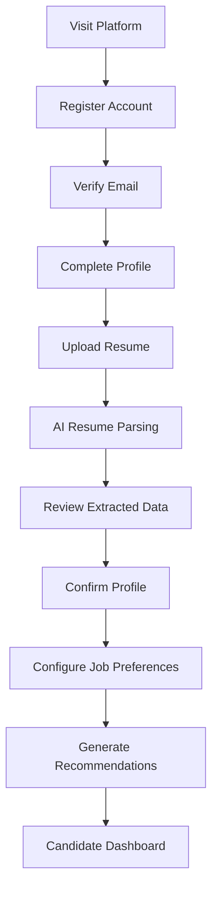
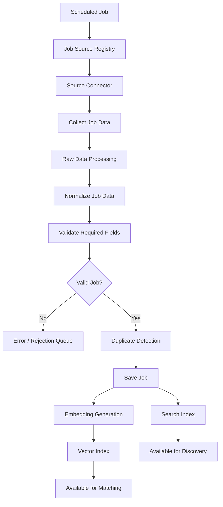
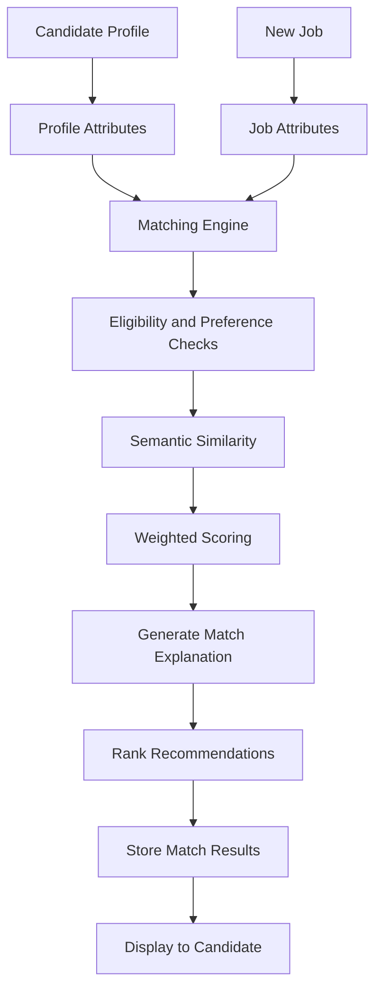
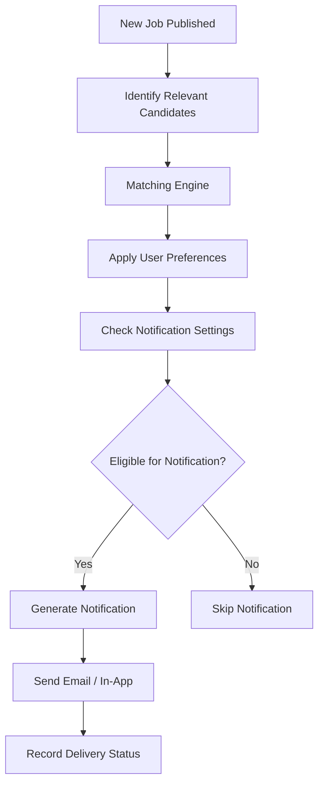

# Product Requirements Document (PRD)
## AI Job Agent Platform – Germany & European Union

| Document information | Details |
|---|---|
| Product | AI Job Agent |
| Business / Owner | Nighwan Technology Pvt. Ltd. |
| Primary market | Germany |
| Expansion market | European Union |
| Product type | AI-powered SaaS / Web Platform |
| Primary users | Job seekers |
| Document status | Draft – Product & Engineering Review |
| Version | 1.0 |
| Date | 25 November 2026 |

---

## 1. Product Overview

### 1.1 Vision

Build a centralized AI-powered job discovery platform that reduces the effort required to find relevant employment opportunities. The platform aggregates jobs from authorized sources, understands job seekers' professional profiles, ranks opportunities by relevance, and helps candidates manage their job search.

### 1.2 Problem Statement

Job seekers in Germany and other EU countries use multiple job portals and company career pages. This creates several problems:

- Job opportunities are distributed across different platforms.
- Candidates repeatedly search for the same positions.
- Relevant opportunities may be missed when candidates do not check portals regularly.
- Keyword search does not always understand the context of a candidate's experience.
- Candidates spend considerable time evaluating whether a job matches their profile.
- Duplicate, outdated, and incomplete listings create unnecessary work.

**Proposed solution:** One platform that aggregates job opportunities and uses AI-assisted matching to identify relevant positions for each candidate.

## 2. Product Goals and Objectives

| Goal | Expected outcome |
|---|---|
| Centralized discovery | Jobs from multiple authorized sources in one place |
| Intelligent matching | Jobs ranked against candidate profiles |
| Automation | Reduce repetitive manual job searching |
| Personalization | Recommendations based on candidate preferences |
| Transparency | Explain why a job is recommended |
| Privacy | GDPR-conscious personal data processing |

### 2.1 Initial Success Metrics

These are proposed MVP targets, not existing performance figures. Validate them using production data.

| Metric | Initial target |
|---|---:|
| Job ingestion success | 95%+ |
| Duplicate job reduction | 98%+ |
| Search response time | Under 2 seconds |
| Matching response time | Under 5 seconds |
| Profile completion rate | 70%+ |
| Relevant recommendation rate | 75%+ |
| Notification delivery success | 95%+ |

## 3. Target Audience

### 3.1 Primary Users – Job Seekers

- Students and fresh graduates.
- Working professionals.
- Software developers and IT professionals.
- Professionals seeking career changes.
- International candidates looking for opportunities in Germany.

**User needs:**
- Discover jobs matching their qualifications.
- Upload and manage resumes.
- Set job preferences.
- Receive job recommendations.
- Track applications.
- Save interesting jobs.

### 3.2 Secondary Users – Platform Administrators

Administrators manage platform operations:

- Manage job sources.
- Monitor data ingestion.
- Review failed ingestion jobs.
- Manage user accounts and support requests.
- Monitor AI matching performance.
- Manage subscriptions and platform settings.
- Handle privacy and compliance requests.

### 3.3 Future Users

Recruiters, employers, recruitment agencies, and corporate HR teams are outside the initial MVP scope.

## 4. Product Scope

### 4.1 MVP Modules

1. Authentication and user management.
2. Candidate profile management.
3. Resume management and parsing.
4. Job aggregation.
5. AI job matching.
6. Job discovery and search.
7. Saved jobs.
8. Application tracker.
9. Notifications.
10. Admin dashboard.

## 5. Functional Requirements

### 5.1 Authentication and User Management

**Objective:** Allow users to securely register and access the platform.

| ID | Requirement | Priority |
|---|---|---|
| FR-001 | Email-based registration | Must |
| FR-002 | Email verification | Must |
| FR-003 | Secure login and logout | Must |
| FR-004 | Password reset | Must |
| FR-005 | Google authentication | Should |
| FR-006 | Account deletion request | Must |
| FR-007 | Secure session management | Must |

**Acceptance criteria:**
- Users can register using a valid email address.
- Email verification is required before restricted functionality is accessed.
- Users can reset passwords.
- Users can request account deletion.
- User data is isolated between accounts.

### 5.2 User Profile Management

**Objective:** Build a structured professional profile for AI-assisted matching.

| Field | Description |
|---|---|
| Full name | Candidate name |
| Email | Verified email |
| Current location | City and country |
| Preferred locations | Desired job locations |
| Professional title | Current or desired designation |
| Experience | Total professional experience |
| Skills | Technical and professional skills |
| Education | Degree and qualification |
| Languages | German, English, etc. |
| Employment type | Full-time, part-time, internship |
| Work preference | Remote, hybrid, onsite |
| Salary expectation | Desired salary range |
| Notice period | Availability |

**Profile functionality:**
- Create and update profiles.
- Add or remove skills.
- Configure preferred locations.
- Set minimum salary expectations.
- Configure employment preferences.
- Control profile visibility and data usage.

### 5.3 Resume Management

**Objective:** Extract structured candidate information from uploaded resumes.

**Supported formats:** PDF and DOCX.

| ID | Requirement |
|---|---|
| FR-020 | Upload resume |
| FR-021 | Validate file type and size |
| FR-022 | Extract text from resume |
| FR-023 | Identify candidate skills |
| FR-024 | Extract education and experience |
| FR-025 | Extract job titles |
| FR-026 | Allow manual corrections |
| FR-027 | Replace or delete uploaded resume |

**Resume processing flow:**

1. User uploads a resume.
2. Platform validates the document.
3. Resume parser extracts text.
4. AI identifies structured information.
5. Candidate reviews extracted information.
6. Candidate confirms or edits the profile.
7. Approved information becomes available to the matching engine.

AI-extracted information must not silently overwrite user-confirmed profile data.

### 5.4 Job Aggregation Engine

**Objective:** Collect job opportunities from multiple external sources.

**Supported source categories:**
- Official job board APIs.
- Public job feeds.
- Employer career pages.
- Authorized third-party job data providers.
- Other sources where automated collection is contractually and legally permitted.

**Job data fields:**

| Field | Description |
|---|---|
| Job ID | Internal unique identifier |
| External ID | Original source ID |
| Job title | Position name |
| Company | Employer name |
| Description | Job description |
| Location | Job location |
| Salary | Salary range, if available |
| Employment type | Full-time / Part-time |
| Experience | Required experience |
| Skills | Required skills |
| Language | Required language |
| Source | Original job source |
| Apply URL | External application link |
| Published date | Original publication date |
| Expiry date | If available |
| Status | Active / Expired / Closed |

**Aggregation requirements:**
- Each source has an independent ingestion configuration.
- Support scheduled job collection.
- Store raw source information for troubleshooting where permitted.
- Normalize source formats into a common schema.
- Identify duplicate listings.
- Detect expired and closed jobs.
- Preserve original source attribution.
- Record last successful synchronization.

### 5.5 AI Job Matching Engine

**Objective:** Determine how relevant each job is to an individual candidate.

The matching engine should evaluate multiple dimensions rather than relying exclusively on keyword similarity.

**Initial configurable scoring model:**

| Parameter | Proposed weight |
|---|---:|
| Skills compatibility | 35% |
| Experience compatibility | 25% |
| Job title relevance | 15% |
| Education compatibility | 10% |
| Location compatibility | 10% |
| Language compatibility | 5% |
| **Total** | **100%** |

Weights are initial product assumptions and must be configurable and validated.

**Matching process:**

1. Read the candidate's confirmed profile attributes.
2. Read normalized job requirements.
3. Apply explicit preference and eligibility checks.
4. Calculate semantic similarity where appropriate.
5. Calculate weighted relevance score.
6. Generate a grounded explanation from the matched attributes.
7. Rank recommendations.
8. Store and display the result.

**Example:**

Candidate:
- 3 years of Java experience.
- Spring Boot and PostgreSQL skills.
- Bachelor's degree in Computer Science.
- Preferred location: Berlin.

Job:
- 2–4 years of Java experience.
- Spring Boot and SQL.
- Bachelor's degree.
- Berlin location.

Possible explanation:
- Strong Java and Spring Boot compatibility.
- Experience falls within the requested range.
- Education requirements are satisfied.
- Location matches the candidate's preference.

A match score is a recommendation indicator, not a guarantee of suitability or an automated employment decision.

### 5.6 Job Discovery and Search

**Search functionality:**
- Search by job title.
- Search by company.
- Search by skills.
- Search by city.
- Search by keyword.
- Search job descriptions.

**Filters:**

| Filter | Options |
|---|---|
| Location | Berlin, Munich, Hamburg, Frankfurt, etc. |
| Salary | Minimum and maximum |
| Experience | Entry, Junior, Mid, Senior |
| Employment | Full-time, Part-time, Internship |
| Work mode | Remote, Hybrid, Onsite |
| Language | German, English |
| Date | Today, Last 3 days, Last 7 days |
| Match score | Configurable range |
| Job status | Active jobs |

**Sorting:**
- Most relevant.
- Newest first.
- Highest salary.
- Highest match score.

### 5.7 Job Details

Each job detail page must include:
- Job title.
- Company information.
- Complete description.
- Required qualifications.
- Required skills.
- Location.
- Salary information, if available.
- Employment type.
- Publication date.
- Source attribution.
- Match score and explanation.
- External application link.

The platform redirects users to the original employer or authorized application destination.

### 5.8 Saved Jobs

Users can:
- Save a job.
- Remove saved jobs.
- View saved opportunities.
- Organize jobs into shortlist categories.
- Identify expired opportunities.
- View previously saved jobs.

### 5.9 Application Tracker

**Objective:** Help users manage applications submitted through external websites.

Suggested application statuses:
- Interested.
- Applied.
- Interview.
- Offer.
- Rejected.
- Withdrawn.

**Requirements:**
- Manually add an application.
- Link an application to an aggregated job.
- Update application status.
- Record application date.
- Add interview dates.
- Add personal notes.
- View application history.
- Filter applications by status.

The MVP must not claim an application was successfully submitted merely because a user clicked an external application link.

### 5.10 Notification System

**Initial channels:**
- Email.
- In-app notifications.

**Notification events:**
- New relevant job available.
- Daily job recommendations.
- Saved job approaching expiry.
- Interview reminder.
- Weekly job-search summary.

**User controls:**
- Enable or disable notifications.
- Configure notification frequency.
- Select minimum match score.
- Choose preferred job categories.

WhatsApp and push notifications are potential future enhancements.

## 6. AI Personal Job Agent

### 6.1 Feature Description

Each registered candidate receives a personalized AI job assistant.

The assistant helps users:
- Find jobs based on their professional profile.
- Understand job descriptions.
- Identify missing skills.
- Compare their profile against job requirements.
- Discover alternative job titles.
- Receive recommendations through conversational interaction.

### 6.2 Example Interaction

**Candidate:** Find Java developer jobs in Berlin requiring 2–4 years of experience.

**AI Assistant:** I found relevant opportunities matching your search criteria. Here are the top recommendations:

- Java Backend Developer – Berlin – 92% illustrative match.
- Spring Boot Developer – Berlin – 87% illustrative match.
- Backend Software Engineer – Berlin – 81% illustrative match.

These are illustrative examples, not live job results.

### 6.3 AI Assistant Requirements

| ID | Requirement | Priority |
|---|---|---|
| AI-001 | Natural-language job search | Must |
| AI-002 | Understand candidate profile | Must |
| AI-003 | Recommend matching jobs | Must |
| AI-004 | Explain job requirements | Must |
| AI-005 | Identify skill gaps | Should |
| AI-006 | Suggest alternative job titles | Should |
| AI-007 | Conversational job discovery | Should |
| AI-008 | Resume improvement suggestions | Could |
| AI-009 | Interview preparation | Could |

### 6.4 AI Assistant Limitations

The AI assistant must:
- Never invent job listings.
- Recommend only jobs existing in the platform database.
- Distinguish extracted facts from AI-generated suggestions.
- Never guarantee an interview or employment.
- Never automatically submit applications without explicit user authorization.
- Avoid using sensitive personal characteristics for ranking.

## 7. Admin Dashboard

### 7.1 Dashboard Overview

Display:
- Total users.
- Active users.
- Total jobs.
- Active jobs.
- Expired jobs.
- Configured job sources.
- Ingestion success rate.
- Matching activity.

### 7.2 User Management

- View registered users.
- Search users.
- View account status.
- Suspend or reactivate accounts.
- View account creation date.
- Handle deletion requests.
- Manage support requests.

Administrators must not receive unrestricted access to private resumes or personal data merely because they have dashboard access.

### 7.3 Job Source Management

Each source should have:
- Source name.
- Source category.
- Source URL.
- Integration type.
- Synchronization frequency.
- Last successful execution.
- Total jobs collected.
- Error count.
- Source status.

Admin actions:
- Add, edit, activate, or deactivate sources.
- Trigger synchronization.
- View execution history.
- View ingestion errors.

### 7.4 Job Management

- View all aggregated jobs.
- Search and filter listings.
- Inspect duplicate records.
- Mark invalid listings.
- Correct extraction errors.
- Review expired jobs.
- Manage source metadata.

### 7.5 AI Monitoring

Monitor:
- Matching requests.
- Average processing time.
- Embedding generation failures.
- Parsing failures.
- Match distribution.
- User feedback on recommendations.
- AI service usage and cost.

### 7.6 Platform Configuration

- Email configuration.
- AI model configuration.
- Job ingestion schedules.
- Matching weights.
- Notification settings.
- Subscription configuration.
- Privacy and retention settings.

## 8. User Experience and Application Screens

The platform must provide a responsive web experience for desktop, tablet, and mobile.

### 8.1 Public Pages

1. Landing page.
2. About the platform.
3. Features.
4. Pricing, if monetization is enabled.
5. Contact.
6. Privacy policy.
7. Terms and conditions.
8. Login.
9. Registration.

### 8.2 Candidate Application

| Screen | Main functionality |
|---|---|
| Dashboard | Personalized job overview |
| My Profile | Manage professional details |
| My Resume | Upload and manage resumes |
| Discover Jobs | Search and filter |
| Recommended Jobs | AI-powered suggestions |
| Job Details | Full job information |
| Saved Jobs | Manage shortlisted jobs |
| Applications | Track application progress |
| AI Assistant | Conversational job discovery |
| Notifications | Manage alerts |
| Settings | Account and privacy settings |

### 8.3 Candidate Dashboard

The dashboard should contain:
- Welcome section.
- Profile completion indicator.
- Recommended jobs.
- Recently published jobs.
- Top matching opportunities.
- Saved jobs summary.
- Application statistics.
- AI assistant entry point.

## 9. User Journey and End-to-End Flows

### 9.1 New User Onboarding



### 9.2 Job Ingestion Flow



### 9.3 AI Matching Flow



### 9.4 Notification Flow



## 10. Non-Functional Requirements

| Category | Requirement |
|---|---|
| Performance | Search API response under 2 seconds at target load |
| Scalability | Horizontally scale ingestion and matching workers |
| Availability | Initial target of 99.5% monthly uptime |
| Security | Encryption in transit and at rest |
| Authentication | Secure session and access management |
| Authorization | Role-based access control |
| Privacy | Data minimization and purpose limitation |
| Accessibility | Target WCAG 2.2 AA |
| Localization | English and German |
| Responsive design | Desktop, tablet, and mobile |
| Logging | Centralized application and audit logs |
| Monitoring | Application health and background job monitoring |
| Backup | Scheduled database and file backups |
| Recovery | Documented recovery and restoration process |

## 11. Privacy, GDPR and EU AI Act Requirements

Privacy must be considered throughout the product lifecycle because the platform processes personal information, including candidate profiles and resumes.

### 11.1 GDPR Requirements

| Requirement | Product implementation |
|---|---|
| Lawful processing | Define and document a lawful basis for each purpose |
| Transparency | Clear privacy notices |
| Data minimization | Collect only necessary information |
| Purpose limitation | Use data only for declared purposes |
| Access rights | Allow users to access their data |
| Rectification | Allow correction of personal information |
| Erasure | Support eligible deletion requests |
| Portability | Provide export functionality where applicable |
| Retention | Define and enforce retention schedules |
| Security | Encryption, access controls, and audit trails |
| Consent | Separate consent where consent is the chosen legal basis |

Consent must not be treated as the universal legal basis for every processing activity. The appropriate lawful basis must be assessed for each purpose.

### 11.2 EU AI Act Considerations

The platform must distinguish between:

1. **Candidate-side job discovery:** Helping a person search and discover employment opportunities.
2. **Employer-side recruitment:** Screening, filtering, or evaluating candidates for employment decisions.

The second category can fall within the EU AI Act's high-risk employment-related AI provisions. A candidate-facing recommendation system is not automatically high-risk simply because it relates to jobs; classification depends on intended purpose and actual use.

If the product later introduces employer-side candidate evaluation, applicable high-risk requirements must be assessed before deployment.

Potential requirements include:
- Risk management.
- Data governance.
- Technical documentation.
- Logging and traceability.
- Human oversight.
- Accuracy and robustness.
- Cybersecurity.
- Post-market monitoring where applicable.

### 11.3 Additional Privacy Controls

- Resume access must be restricted.
- Personal information must not be exposed to external job sources.
- AI service providers must be reviewed for data-processing terms.
- Cross-border transfers must have an appropriate legal mechanism.
- Users must be able to control optional notifications.
- Personal data must be removed from applicable indexes and backups according to documented deletion and retention policies.

Legal counsel should validate the final data flows, source collection practices, and AI Act classification before launch.

## 12. External Integrations

| Integration | Purpose | Priority |
|---|---|---|
| Job board APIs | Job collection | Must |
| Company career pages | Job collection | Must |
| OpenAI / compatible LLM | AI assistance and extraction | Should |
| Embedding model | Semantic matching | Must |
| Email provider | Notifications and verification | Must |
| Google OAuth | Authentication | Should |
| Object storage | Resume storage | Must |
| Analytics service | Product analytics | Should |
| Payment gateway | Subscription billing | Future |

External integrations should be replaceable without redesigning the entire product.

## 13. Recommended System Architecture

### 13.1 High-Level Architecture

```text
[ PRESENTATION LAYER ]
Candidate Web App | Admin Dashboard | Public API
                  |
                  v
[ APPLICATION SERVICES ]
Authentication | Profile | Jobs | Search
Applications | Notifications | Admin
                  |
          +-------+-------+
          |               |
          v               v
[ AI SERVICES ]    [ INGESTION SERVICES ]
Resume Parser      Scrapy
Embeddings         Playwright
Matching Engine    API Connectors
AI Assistant       Schedulers
          |               |
          +-------+-------+
                  |
                  v
[ DATA INFRASTRUCTURE ]
PostgreSQL | Redis | Search Index
Vector Storage | Object Storage
                  |
                  v
[ SECURITY & GOVERNANCE ]
GDPR | Access Control | Audit Logs
Monitoring | Backup | Retention
```

### 13.2 Suggested Technology Stack

| Component | Recommended technology |
|---|---|
| Frontend | Next.js / React |
| Backend | Node.js / NestJS |
| AI services | Python / FastAPI |
| Scraping | Scrapy + Playwright |
| Primary database | PostgreSQL |
| Cache | Redis |
| Search engine | Elasticsearch / OpenSearch |
| Vector storage | pgvector |
| File storage | S3-compatible storage |
| Queue | RabbitMQ |
| AI models | OpenAI API / Hugging Face |
| Deployment | Docker |
| Reverse proxy | Nginx |
| Monitoring | Prometheus + Grafana |

**Architecture recommendation:** Start with a modular backend and independently scalable ingestion and AI workers. Avoid introducing Kubernetes or excessive microservices during the MVP.

## 14. Subscription and Monetization

The platform can initially launch with a free candidate account and introduce paid plans after validating user engagement.

| Feature | Free | Premium |
|---|---|---|
| Job search | Yes | Yes |
| Saved jobs | Limited | Unlimited |
| Basic matching | Yes | Yes |
| Advanced AI matching | Limited | Yes |
| AI assistant | Limited | Extended |
| Job alerts | Basic | Advanced |
| Application tracker | Yes | Yes |
| Resume analysis | Limited | Extended |
| Skill gap analysis | No | Yes |

Pricing should be decided after market research in Germany.

## 15. Out of Scope – Initial MVP

The following capabilities are excluded from the first release:

1. Automatic job applications.
2. Employer recruitment dashboard.
3. Recruiter candidate search.
4. Automated candidate screening for employers.
5. Video interview platform.
6. Payroll management.
7. HRMS functionality.
8. WhatsApp automation.
9. Native Android and iOS applications.
10. Automated interview scheduling with employers.

These features may be considered in later releases.

## 16. Product Development Roadmap

Indicative timeline, subject to team size, integrations, source access, and testing.

| Phase | Timeline | Deliverables |
|---|---|---|
| Phase 1 – Product Foundation | Weeks 1–2 | Authentication, profiles, database foundation, initial UI |
| Phase 2 – Job Aggregation | Weeks 3–4 | Source integrations, Scrapy, Playwright, normalization, deduplication |
| Phase 3 – AI Intelligence | Weeks 5–6 | Resume parser, skill extraction, embeddings, matching engine |
| Phase 4 – Candidate Platform | Weeks 7–8 | Job discovery, recommendations, saved jobs, tracker, notifications |
| Phase 5 – Admin & Compliance | Weeks 9–10 | Admin dashboard, source monitoring, privacy controls, audit logs |
| Phase 6 – Testing & Launch | Weeks 11–12 | Functional testing, AI evaluation, performance testing, UAT, deployment |

## 17. Risks and Mitigation

| Risk | Impact | Mitigation |
|---|---|---|
| Job source restrictions | High | Use authorized APIs and feeds |
| Scraping failures | High | Source-specific monitoring and retries |
| Duplicate listings | Medium | Multi-field deduplication |
| Outdated jobs | High | Expiry and freshness checks |
| Incorrect AI matching | High | Evaluation datasets and user feedback |
| Resume parsing errors | Medium | User verification |
| AI service costs | Medium | Usage limits and caching |
| GDPR violations | High | Privacy review and governance |
| Data breaches | High | Encryption and access controls |
| Low user engagement | Medium | Personalized alerts and UX improvements |

## 18. Acceptance Criteria – MVP Release

The MVP will be considered ready for launch when all mandatory requirements below are satisfied:

- [ ] Users can register, verify email, and log in.
- [ ] Users can create and update professional profiles.
- [ ] Users can upload PDF and DOCX resumes.
- [ ] Resume information can be extracted and manually corrected.
- [ ] At least three authorized job sources are integrated.
- [ ] Jobs are normalized into a common database structure.
- [ ] Duplicate jobs are detected and handled.
- [ ] Users can search jobs and apply filters.
- [ ] AI matching produces explainable recommendations.
- [ ] Users can save and remove jobs.
- [ ] Users can track applications manually.
- [ ] Email and in-app notifications work.
- [ ] Administrators can monitor jobs and ingestion sources.
- [ ] Account deletion and applicable data rights are supported.
- [ ] Security, privacy, and functional testing are completed.

## 19. Open Business Decisions

These decisions require stakeholder approval before development is finalized.

| Decision | Proposed direction |
|---|---|
| Initial market | Germany |
| Initial language | English, with German support |
| Initial audience | Job seekers |
| Job sources | Authorized APIs and permitted career pages |
| Account model | Free initially |
| Application submission | External redirect |
| AI matching | Hybrid rule-based + semantic |
| Notifications | Email + in-app |
| Hosting | EU data residency preference |
| Employer portal | Future phase |

## 20. Final Product Definition

The AI Job Agent should be developed as a centralized job intelligence platform, not merely a job listing website.

Its main value proposition is the combination of:

1. **Job Aggregation:** Collect opportunities from multiple authorized sources.
2. **AI Intelligence:** Understand candidate profiles and job requirements.
3. **Personalized Matching:** Recommend opportunities based on relevant professional criteria.
4. **Job Automation:** Continuously discover and notify users about new opportunities.
5. **Application Management:** Provide a centralized job-search workspace.
6. **Privacy by Design:** Build the platform with appropriate EU privacy and AI governance controls.

---

## 21. Reference Documentation

The PRD structure follows common product documentation practices, including measurable goals, prioritized requirements, acceptance criteria, scope boundaries, and release planning.

- Product requirements should be validated with business stakeholders and engineering.
- GDPR and EU AI Act applicability should be reviewed with qualified legal counsel before launch.
- Job-source access and automated collection must be reviewed against each provider's terms and applicable law.

---

**Recommended next deliverable:** A detailed Software Requirements Specification (SRS), including database entities, API specifications, screen-by-screen requirements, permissions, error handling, and technical architecture.
