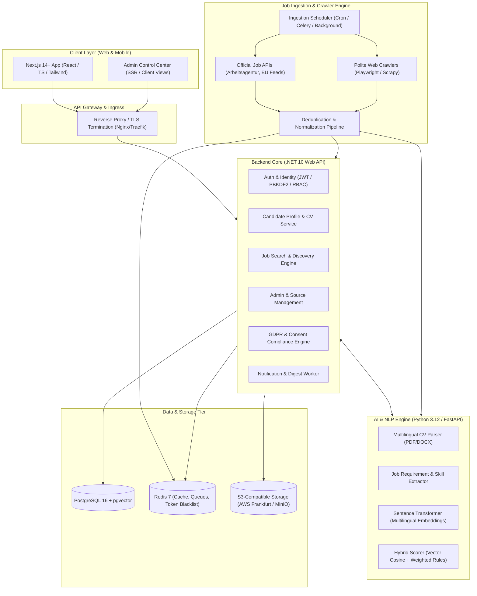

# AI Job Agent Platform – Architecture & System Design
**Owner:** Nighwan Technology Pvt. Ltd.  
**Target Market:** Germany & European Union (DE / EN)  
**Version:** 1.0.0 (Production Blueprint)

---

## 1. Executive Summary

The **AI Job Agent Platform** is an enterprise-grade job aggregation, parsing, and semantic matching ecosystem designed specifically for the German and European job markets. The platform empowers job seekers with multilingual (German & English) AI-powered profile analysis, resume parsing, vector-based semantic matching, job alerts, and an application tracker. For platform operators and enterprises, it provides automated multi-source job crawling, source health monitoring, deduplication, and an administrative control panel.

The architecture is built on **Privacy by Design**, fully adhering to the European General Data Protection Regulation (**GDPR**, Regulation EU 2016/679) and evaluating requirements under the **EU Artificial Intelligence Act** (Regulation EU 2024/1689).

---

## 2. High-Level System Architecture

---

## 3. Technology Stack Justification

| Layer | Technology | Decision Rationale |
| :--- | :--- | :--- |
| **Frontend** | **Next.js 14+ (App Router), React, TypeScript, Tailwind CSS** | Server-side rendering (SSR) for lightning-fast public pages and SEO in German/English markets; type safety; modular component design; zero-runtime CSS footprint with Tailwind. |
| **Backend Core** | **.NET 10 Web API (C#)** | High-throughput, low-latency asynchronous runtime; enterprise-grade dependency injection, Entity Framework Core with native PostgreSQL/pgvector support, strongly typed CQRS architecture. |
| **AI / NLP Service** | **Python 3.12, FastAPI, SentenceTransformers, spaCy, PyPDF** | Rich ecosystem for NLP, multilingual text extraction, vector embeddings (`paraphrase-multilingual-MiniLM-L12-v2`), and explainable AI generation. |
| **Relational & Vector DB** | **PostgreSQL 16 with `pgvector`** | Unified database eliminating split-brain state between relational relational metadata (users, applications, logs) and high-dimensional semantic embeddings (384-dim or 768-dim vectors). Native indexing via HNSW and IVFFlat. |
| **Cache & Queue** | **Redis 7** | Sub-millisecond session caching, refresh token blacklisting, ingestion task queueing, and distributed rate limiting. |
| **Document Storage** | **S3-compatible (AWS Frankfurt `eu-central-1` / MinIO)** | Encrypted at rest (AES-256), strict EU data residency compliance, signed pre-authenticated download/upload URLs. |
| **Job Ingestion** | **Scrapy & Playwright with Rate Limiting** | Headless browser execution for dynamic client-rendered career portals with strict respect for `robots.txt`, exponential backoff, and IP pooling. |

---

## 4. Multi-Tenant Role-Based Access Control (RBAC)

The platform enforces strict role-based authorization across five hierarchical roles:
1. **Super Admin:** Full platform ownership, system configuration, audit logs, billing, AI weight recalibration, admin user creation.
2. **Admin:** Daily operations, job source monitoring, content moderation, candidate support management.
3. **Data Operator:** Job source onboarding, crawler verification, job categorization review, deduplication overrides.
4. **Support:** Read-only candidate troubleshooting, notification resend, consent lookup.
5. **Candidate:** Self-service profile, CV upload, match explorer, job search, application tracking, privacy/GDPR self-service (data export, account deletion).

---

## 5. Security & Privacy-by-Design Standards

1. **Authentication:**
   - Identity management with salted PBKDF2 / Argon2 password hashing.
   - Short-lived Access Tokens (JWT, 15-minute expiry) signed with asymmetric RS256 or strong HMAC-SHA256.
   - Long-lived Refresh Tokens (7-day sliding expiry) stored in HTTP-only, Secure, SameSite cookies and tracked in Redis for immediate revocation.
2. **Transport Security:**
   - Strict HTTPS/TLS 1.3 only with HSTS headers.
   - CORS policy strictly bounded to trusted domain origins.
3. **At-Rest Protection:**
   - Database disk volume encryption (AWS KMS / LUKS).
   - Sensitive PII fields hashed or encrypted where required.
4. **German / EU Legal Adherence:**
   - EU Data Hosting: AWS Frankfurt (`eu-central-1`) exclusively.
   - Zero discriminatory bias: No age, gender, race, religion, or disability data is processed or scored in matching algorithms.
   - Explainable Match Reasoning: Transparent scoring breakdown provided to candidate.
