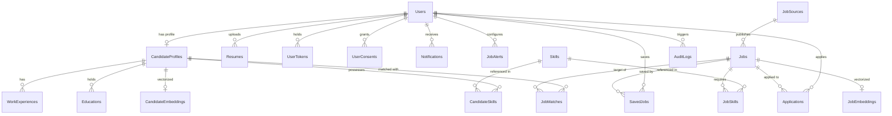

# Database Design & Entity Relationship Specification
**Platform:** AI Job Agent Platform (Germany / EU)  
**Database Engine:** PostgreSQL 16+ with `pgvector` extension  
**ORM:** Entity Framework Core (.NET 10) / SQLAlchemy / Alembic  

---

## 1. Entity Relationship Overview

The schema is structured into 6 logical domains:
1. **Identity & Authorization:** `Users`, `AdminRoles`, `UserTokens`
2. **Candidate Domain:** `CandidateProfiles`, `Resumes`, `Skills`, `CandidateSkills`, `WorkExperiences`, `Educations`, `CandidateEmbeddings`
3. **Job Domain:** `JobSources`, `Jobs`, `JobSkills`, `JobEmbeddings`
4. **Matching & Recommendations:** `JobMatches`, `MatchingWeightsConfig`
5. **Candidate Activity:** `SavedJobs`, `Applications`, `JobAlerts`, `Notifications`
6. **Governance & Compliance:** `UserConsents`, `AuditLogs`, `SystemSettings`



---

## 2. Table Specifications

### 2.1 Identity & Authorization

#### `Users`
| Column | Type | Constraints | Description |
| :--- | :--- | :--- | :--- |
| `id` | `UUID` | PK, default `gen_random_uuid()` | Primary Key |
| `email` | `VARCHAR(255)` | NOT NULL, UNIQUE, indexed | User email |
| `password_hash` | `VARCHAR(255)` | NOT NULL | Hashed password (Argon2id/PBKDF2) |
| `first_name` | `VARCHAR(100)` | NOT NULL | First name |
| `last_name` | `VARCHAR(100)` | NOT NULL | Last name |
| `phone_number` | `VARCHAR(50)` | NULL | Contact phone number |
| `role` | `VARCHAR(50)` | NOT NULL, default `'Candidate'` | Enum: SuperAdmin, Admin, Support, DataOperator, Candidate |
| `is_email_verified` | `BOOLEAN` | NOT NULL, default `FALSE` | Email verification flag |
| `is_active` | `BOOLEAN` | NOT NULL, default `TRUE` | Account status |
| `is_deleted` | `BOOLEAN` | NOT NULL, default `FALSE` | Soft delete flag |
| `created_at` | `TIMESTAMPTZ` | NOT NULL, default `NOW()` | Record creation timestamp |
| `updated_at` | `TIMESTAMPTZ` | NOT NULL, default `NOW()` | Last update timestamp |
| `deleted_at` | `TIMESTAMPTZ` | NULL | Soft delete timestamp |

#### `UserConsents` (GDPR Compliance Ledger)
| Column | Type | Constraints | Description |
| :--- | :--- | :--- | :--- |
| `id` | `UUID` | PK | Consent record ID |
| `user_id` | `UUID` | FK -> Users(id), CASCADE | User ID |
| `consent_type` | `VARCHAR(100)` | NOT NULL | E.g., `TERMS_OF_SERVICE`, `PRIVACY_POLICY`, `MARKETING_EMAIL`, `AI_MATCHING_ANALYSIS` |
| `is_granted` | `BOOLEAN` | NOT NULL | Whether consent was given or revoked |
| `ip_address` | `VARCHAR(45)` | NULL | Anonymized/truncated IP address |
| `user_agent` | `TEXT` | NULL | Browser user agent string |
| `policy_version`| `VARCHAR(20)` | NOT NULL | Policy version agreed upon (e.g. `2026.1`) |
| `created_at` | `TIMESTAMPTZ` | NOT NULL, default `NOW()` | Timestamp of consent action |

---

### 2.2 Candidate Profile & CV Management

#### `CandidateProfiles`
| Column | Type | Constraints | Description |
| :--- | :--- | :--- | :--- |
| `id` | `UUID` | PK | Profile ID |
| `user_id` | `UUID` | FK -> Users(id), UNIQUE | Associated User |
| `headline` | `VARCHAR(255)` | NULL | Professional headline (e.g. "Senior Full-Stack Engineer") |
| `summary` | `TEXT` | NULL | Professional biography |
| `years_of_experience`| `NUMERIC(4,1)` | default `0.0` | Total verified years of professional experience |
| `current_location` | `VARCHAR(150)` | NULL | City, Country (e.g. "Berlin, Germany") |
| `preferred_locations` | `TEXT[]` | NULL | Array of preferred cities/regions in Germany/EU |
| `preferred_employment_types` | `TEXT[]` | NULL | Array: `FullTime`, `PartTime`, `Contract`, `Internship` |
| `remote_preference` | `VARCHAR(50)` | default `'Flexible'` | `OnSite`, `Hybrid`, `Remote`, `Flexible` |
| `expected_salary_currency` | `VARCHAR(3)` | default `'EUR'` | ISO Currency code (EUR) |
| `expected_salary_min` | `INTEGER` | NULL | Minimum annual gross salary expectation |
| `expected_salary_max` | `INTEGER` | NULL | Target annual gross salary expectation |
| `notice_period_days` | `INTEGER` | NULL | Notice period in days (e.g. 30, 60, 90) |
| `languages` | `JSONB` | default `'[]'` | List of languages and levels: `[{"lang": "German", "level": "C1"}, {"lang": "English", "level": "Fluent"}]` |
| `is_profile_complete` | `BOOLEAN` | default `FALSE` | Profile readiness indicator |
| `created_at` | `TIMESTAMPTZ` | default `NOW()` | Creation time |
| `updated_at` | `TIMESTAMPTZ` | default `NOW()` | Modification time |

#### `Resumes`
| Column | Type | Constraints | Description |
| :--- | :--- | :--- | :--- |
| `id` | `UUID` | PK | Resume document ID |
| `user_id` | `UUID` | FK -> Users(id), CASCADE | Candidate ID |
| `file_name` | `VARCHAR(255)` | NOT NULL | Original upload file name |
| `file_url` | `VARCHAR(1024)`| NOT NULL | Encrypted S3 object key / secure path |
| `file_size_bytes` | `BIGINT` | NOT NULL | File size |
| `mime_type` | `VARCHAR(100)` | NOT NULL | `application/pdf`, `application/vnd.openxmlformats-officedocument.wordprocessingml.document` |
| `is_primary` | `BOOLEAN` | default `TRUE` | Whether this is the active matching CV |
| `raw_text` | `TEXT` | NULL | Extracted textual content |
| `parsed_data` | `JSONB` | NULL | Structured parsed output (skills, education, companies) |
| `parsing_status`| `VARCHAR(50)` | default `'Pending'` | `Pending`, `Processing`, `Completed`, `Failed` |
| `parsing_error` | `TEXT` | NULL | Error details if parsing failed |
| `created_at` | `TIMESTAMPTZ` | default `NOW()` | Upload date |
| `updated_at` | `TIMESTAMPTZ` | default `NOW()` | Last modification |

#### `Skills` & `CandidateSkills`
| Table | Key Columns | Description |
| :--- | :--- | :--- |
| `Skills` | `id (UUID)`, `name (VARCHAR(100) UNIQUE)`, `category (VARCHAR(100))` | Normalized taxonomy of tech & soft skills |
| `CandidateSkills` | `candidate_profile_id (UUID FK)`, `skill_id (UUID FK)`, `years_of_experience (NUMERIC)`, `proficiency_level (VARCHAR)` | Association table connecting candidates with validated skills |

#### `WorkExperiences` & `Educations`
- `WorkExperiences`: `id`, `candidate_profile_id`, `company_name`, `job_title`, `location`, `start_date`, `end_date`, `is_current`, `description`, `skills_used (TEXT[])`.
- `Educations`: `id`, `candidate_profile_id`, `institution_name`, `degree`, `field_of_study`, `start_date`, `end_date`, `grade`.

---

### 2.3 Job Ingestion & Market Domain

#### `JobSources`
| Column | Type | Constraints | Description |
| :--- | :--- | :--- | :--- |
| `id` | `UUID` | PK | Source identifier |
| `source_name` | `VARCHAR(150)` | NOT NULL, UNIQUE | E.g. "Bundesagentur für Arbeit API", "TechCareers DE" |
| `source_type` | `VARCHAR(50)` | NOT NULL | `API`, `RSS_FEED`, `SCRAPER_PLAYWRIGHT`, `SCRAPER_SCRAPY` |
| `source_url` | `VARCHAR(1024)`| NOT NULL | Root endpoint or website |
| `auth_credentials`| `JSONB` | NULL | Encrypted API keys / tokens if required |
| `collection_frequency_hours`| `INTEGER` | default `24` | Ingestion cycle interval |
| `is_active` | `BOOLEAN` | default `TRUE` | Enable/disable crawler |
| `last_successful_run_at`| `TIMESTAMPTZ`| NULL | Last successful sync |
| `total_jobs_collected` | `BIGINT` | default `0` | Historical counter |
| `last_error_log` | `TEXT` | NULL | Diagnostic failure string |
| `created_at` | `TIMESTAMPTZ` | default `NOW()` | Registration date |
| `updated_at` | `TIMESTAMPTZ` | default `NOW()` | Update date |

#### `Jobs`
| Column | Type | Constraints | Description |
| :--- | :--- | :--- | :--- |
| `id` | `UUID` | PK | Job ID |
| `source_id` | `UUID` | FK -> JobSources(id) | Originating source |
| `external_id` | `VARCHAR(255)` | NOT NULL | Source-specific job identifier |
| `title` | `VARCHAR(255)` | NOT NULL, indexed | Standardized job title |
| `company_name` | `VARCHAR(255)` | NOT NULL, indexed | Hiring company |
| `company_logo_url` | `VARCHAR(1024)` | NULL | Company branding |
| `location_city`| `VARCHAR(100)` | NOT NULL, indexed | City (e.g. Munich, Berlin, Hamburg, Frankfurt) |
| `location_country` | `VARCHAR(100)` | NOT NULL, default `'Germany'` | Country (Germany / EU member state) |
| `is_remote` | `BOOLEAN` | default `FALSE` | Remote availability |
| `workplace_type`| `VARCHAR(50)` | default `'OnSite'` | `OnSite`, `Hybrid`, `Remote` |
| `employment_type`| `VARCHAR(50)` | default `'FullTime'` | `FullTime`, `PartTime`, `Contract` |
| `experience_level`| `VARCHAR(50)` | default `'MidLevel'` | `Junior`, `MidLevel`, `Senior`, `Lead`, `Executive` |
| `salary_min` | `INTEGER` | NULL | Minimum annual salary in EUR |
| `salary_max` | `INTEGER` | NULL | Maximum annual salary in EUR |
| `salary_currency` | `VARCHAR(3)` | default `'EUR'` | Currency (EUR) |
| `required_languages` | `JSONB` | default `'[]'` | Requirements, e.g. `[{"lang": "German", "level": "B2"}]` |
| `description` | `TEXT` | NOT NULL | Cleaned full job description |
| `description_html` | `TEXT` | NULL | Raw formatted HTML |
| `application_url` | `VARCHAR(1024)`| NOT NULL | Direct apply link |
| `posted_at` | `TIMESTAMPTZ` | NOT NULL, indexed | Date published by employer |
| `expires_at` | `TIMESTAMPTZ` | NULL | Expiration date |
| `dedup_hash` | `VARCHAR(64)` | NOT NULL, UNIQUE | SHA-256 hash of normalized (company + title + city) |
| `is_active` | `BOOLEAN` | default `TRUE` | Whether job is currently open |
| `created_at` | `TIMESTAMPTZ` | default `NOW()` | Ingestion date |
| `updated_at` | `TIMESTAMPTZ` | default `NOW()` | Last modified date |

---

### 2.4 Vector Search & AI Matching Entities

#### `CandidateEmbeddings` & `JobEmbeddings`
```sql
CREATE EXTENSION IF NOT EXISTS vector;

CREATE TABLE candidate_embeddings (
    candidate_profile_id UUID PRIMARY KEY REFERENCES candidate_profiles(id) ON DELETE CASCADE,
    embedding vector(384) NOT NULL, -- MiniLM 384 dimensions
    model_version VARCHAR(50) NOT NULL,
    updated_at TIMESTAMPTZ NOT NULL DEFAULT NOW()
);

CREATE TABLE job_embeddings (
    job_id UUID PRIMARY KEY REFERENCES jobs(id) ON DELETE CASCADE,
    embedding vector(384) NOT NULL,
    model_version VARCHAR(50) NOT NULL,
    updated_at TIMESTAMPTZ NOT NULL DEFAULT NOW()
);

-- HNSW Vector Indexes for Sub-millisecond Cosine Distance Search
CREATE INDEX idx_candidate_embeddings_hnsw 
ON candidate_embeddings 
USING hnsw (embedding vector_cosine_ops)
WITH (m = 16, ef_construction = 64);

CREATE INDEX idx_job_embeddings_hnsw 
ON job_embeddings 
USING hnsw (embedding vector_cosine_ops)
WITH (m = 16, ef_construction = 64);
```

#### `JobMatches` (AI Recommendations Store)
| Column | Type | Constraints | Description |
| :--- | :--- | :--- | :--- |
| `id` | `UUID` | PK | Match identifier |
| `candidate_profile_id` | `UUID` | FK -> CandidateProfiles(id) | Candidate reference |
| `job_id` | `UUID` | FK -> Jobs(id) | Job reference |
| `overall_match_score` | `NUMERIC(5,2)` | NOT NULL, indexed | Final score (0.00% - 100.00%) |
| `skills_score` | `NUMERIC(5,2)` | NOT NULL | Sub-score: Skills compatibility |
| `experience_score`| `NUMERIC(5,2)` | NOT NULL | Sub-score: Years & seniority match |
| `location_score` | `NUMERIC(5,2)` | NOT NULL | Sub-score: City/Country/Remote fit |
| `language_score` | `NUMERIC(5,2)` | NOT NULL | Sub-score: German & English compatibility |
| `salary_score` | `NUMERIC(5,2)` | NOT NULL | Sub-score: Budget vs expectation |
| `vector_cosine_similarity` | `NUMERIC(5,4)` | NOT NULL | Raw embedding similarity (0.0 - 1.0) |
| `matching_skills`| `TEXT[]` | NOT NULL | Array of matched skills |
| `missing_skills` | `TEXT[]` | NOT NULL | Array of skills candidate lacks |
| `explanation` | `JSONB` | NOT NULL | Structured explainable breakdown |
| `is_dismissed` | `BOOLEAN` | default `FALSE` | User hid recommendation |
| `created_at` | `TIMESTAMPTZ` | default `NOW()` | Score calculation date |
| `updated_at` | `TIMESTAMPTZ` | default `NOW()` | Recalculation date |

#### `MatchingWeightsConfig` (Admin-Configurable Scoring)
| Column | Type | Default | Description |
| :--- | :--- | :--- | :--- |
| `id` | `UUID` | PK | Configuration ID |
| `skills_weight` | `NUMERIC(3,2)` | `0.40` | Skills weight (40%) |
| `experience_weight` | `NUMERIC(3,2)` | `0.25` | Experience weight (25%) |
| `location_weight` | `NUMERIC(3,2)` | `0.15` | Location weight (15%) |
| `language_weight` | `NUMERIC(3,2)` | `0.10` | Language weight (10%) |
| `salary_weight` | `NUMERIC(3,2)` | `0.10` | Salary weight (10%) |
| `is_active` | `BOOLEAN` | `TRUE` | Active weight configuration |
| `updated_by` | `UUID` | NULL | Admin who changed weights |
| `updated_at` | `TIMESTAMPTZ` | `NOW()` | Timestamp |

---

### 2.5 Candidate Activity & Governance

- `SavedJobs`: `id`, `user_id`, `job_id`, `notes`, `created_at` (UNIQUE `user_id` + `job_id`).
- `Applications`: `id`, `user_id`, `job_id`, `status` (`Saved`, `Applied`, `Interviewing`, `Offered`, `Rejected`, `Withdrawn`), `applied_at`, `notes`, `updated_at`.
- `Notifications`: `id`, `user_id`, `type`, `title`, `message`, `data (JSONB)`, `is_read`, `created_at`.
- `AuditLogs`: `id`, `user_id`, `action`, `resource_type`, `resource_id`, `details (JSONB)`, `ip_address`, `created_at`.

