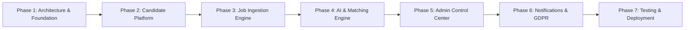

# Comprehensive Implementation Roadmap
**Platform:** AI Job Agent Platform (Germany / EU)  
**Engineering Organization:** Nighwan Technology Pvt. Ltd.  

---

## Roadmap Overview

---

## Detailed Phase Breakdown

### Phase 1: Architecture and Project Foundation (Current Phase)
- [x] Inspect workspace and system environment.
- [x] Create clean monorepo structure.
- [x] Define System Architecture, Database ERD, REST API Contracts, and GDPR Compliance specifications.
- [ ] Initialize PostgreSQL with `pgvector` schema scripts & migrations.
- [ ] Implement .NET 10 Web API Core Domain, Application, and Infrastructure foundation with JWT authentication & RBAC.
- [ ] Set up Next.js 14+ frontend with Tailwind CSS European SaaS design system.

### Phase 2: Candidate Platform
- [ ] Candidate Registration, Login, and Email Verification.
- [ ] Candidate Profile Builder (headline, summary, skills, experience, education, salary, notice period, German/English language levels).
- [ ] Resume Upload & Document Management (PDF / DOCX handling, storage abstractions).
- [ ] Interactive CV Review & manual correction interface.
- [ ] Job Search & filtering UI (location, remote, salary, language).

### Phase 3: Job Aggregation & Ingestion Engine
- [ ] Job Source Management System (Metadata, API keys, intervals, health monitoring).
- [ ] Multi-source connector modules (Official Job APIs, German Bundesagentur für Arbeit schema, RSS/JSON feeds, Playwright/Scrapy crawlers).
- [ ] Normalization, validation, and deduplication pipeline (dedup hashes, salary parsing, city mapping).
- [ ] Ingestion scheduler and queue worker.

### Phase 4: AI Matching & NLP Engine
- [ ] Multilingual Resume Parser service in Python FastAPI.
- [ ] Job Description Skill & Requirement Extractor.
- [ ] Semantic vector embedding generation (`paraphrase-multilingual-MiniLM-L12-v2`).
- [ ] PostgreSQL pgvector cosine distance search.
- [ ] Hybrid Scoring Algorithm (Skills 40%, Experience 25%, Location 15%, Language 10%, Salary 10%).
- [ ] Transparent, explainable recommendation generator.

### Phase 5: Admin Dashboard
- [ ] Real-time operational metrics & KPI dashboard (active users, daily ingested jobs, active sources, match metrics).
- [ ] User and role management (SuperAdmin, Admin, DataOperator, Support).
- [ ] Job catalog management and moderation.
- [ ] Scraper health monitoring and manual trigger controls.
- [ ] Dynamic AI matching weights configuration.
- [ ] System audit logs explorer.

### Phase 6: Notification Engine & GDPR Workflows
- [ ] Notification service (New matches, daily/weekly job digest, application reminders).
- [ ] GDPR Data Subject Rights portal (Data export in JSON, account deletion cascade, consent management ledger).
- [ ] Security hardening, rate limiting, and CORS verification.

### Phase 7: Testing, Docker & Production Readiness
- [ ] Unit & integration test suites.
- [ ] Multi-stage Dockerfiles for all microservices.
- [ ] `docker-compose.yml` for local and staging deployment.
- [ ] Production deployment guide and environment configuration template.

